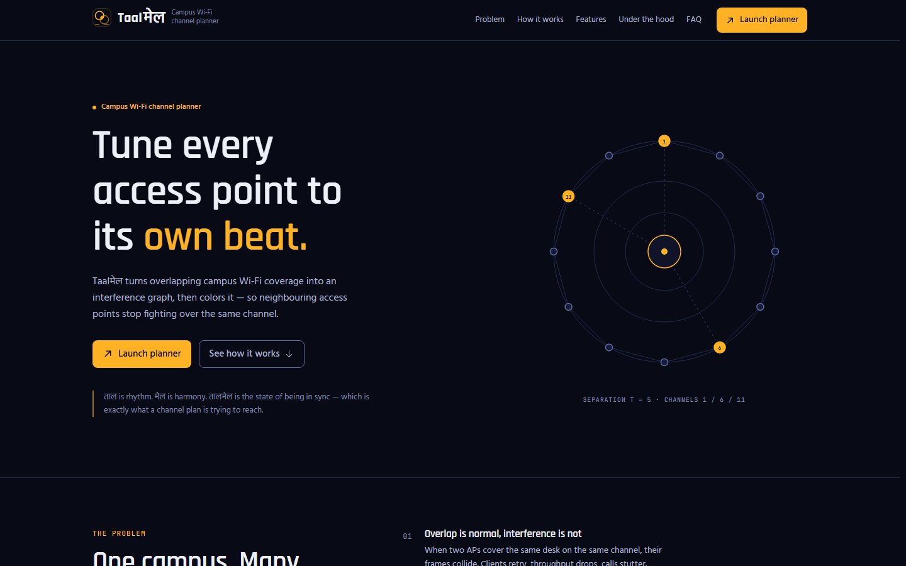
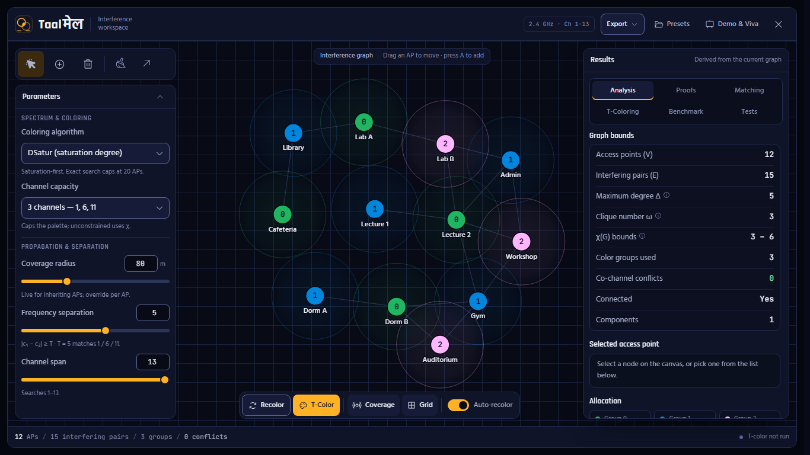

# Taalमेल

**Campus Wi-Fi channel planner.** Taalमेल turns overlapping campus Wi-Fi coverage into an interference graph and
colours it, so neighbouring access points stop fighting over the same channel.

ताल is rhythm. मेल is harmony. तालमेल is the state of being in sync — which is exactly what a channel plan is trying
to reach.



## What it does

- Place APs on a dark plotting canvas; two APs become adjacent when their coverage discs overlap.
- Colour the graph with DSatur, Welsh–Powell, greedy or exact backtracking, capped at 3/4/5 groups or unconstrained.
- Run a real T-colouring search: channels 1–N with `|c₁ − c₂| ≥ T` on every interfering edge.
- Inspect why a result is infeasible (clique span bound), not just that it failed.
- Explore proofs (pigeonhole, planarity, Euler, articulation points, chromatic polynomial), bipartite matching and
  Hall's condition, benchmark all four colourings, and run the seven-graph reference suite.
- Load eight presets, follow the six-step Demo & Viva script, and export topology JSON or the plotted PNG.
- Work offline: fonts are self-hosted and no request leaves the page after load.



## Quick start

Requires Node 20+ and npm.

```bash
git clone https://github.com/sayeetope/taalmel.git
cd taalmel
npm ci
npm run dev        # http://localhost:5173
```

Open the planner with the **Launch planner** button or `/#planner`. Browser Back closes it; the graph survives closing
and reopening because planner state lives outside the dialog.

| Script | Purpose |
|---|---|
| `npm run dev` | Vite dev server |
| `npm run build` | Type-check and produce `dist/` |
| `npm run preview` | Serve the production build |
| `npm run typecheck` | `tsc -b` |
| `npm run lint` | ESLint, including architecture boundaries |
| `npm test` | Vitest unit + parity suite |
| `npm run test:e2e` | Playwright + axe (starts its own dev server) |

## Architecture

```
src/
  app/            App shell, providers, route state
  config/         Optional author / college / repo credits
  design/         tokens.css, channelColors.ts
  components/ui/  Button, Slider, Select, Tabs, Badge, Switch, Tooltip, Dialog, Toasts
  features/
    marketing/    Home sections + all copy in content/home.ts
    planner/
      canvas/     CanvasStage, renderer, hitTest, view, sprites
      chrome/     ActionBar, ToolDock, StatusStrip, ExportMenu, dialogs
      panels/     ParametersCard, ResultsDrawer, six tabs
      store/      Zustand store + deriveGraph
      workers/    solver worker and typed client
  engine/         Pure TypeScript: graph, coloring, tcoloring, analysis,
                  chromatic, matching, benchmark, presets
  lib/            rAF scheduler
tests/            unit, fixtures, e2e
docs/             inventory, research, design system, wireframes, perf, QA
```

Boundaries are enforced by ESLint: `engine/` imports no React, DOM or feature code; UI primitives import no features;
the marketing surface imports no planner internals.

### Data flow

1. Pointer/inputs update the Zustand store.
2. `deriveGraph` builds the adjacency matrix from AP centres and effective radii (`ap.radius ?? defaultRadius`).
3. The chosen colouring is computed once per committed edit; the store keeps graph, colouring and stats together.
4. The canvas reads committed state through narrow selectors. During a drag, the position lives only in the renderer
   as a transient; React commits on pointer-up.
5. T-colouring, benchmark, tests and the chromatic polynomial run in a Web Worker. T-colouring results carry the
   revision they were computed from; any topology or constraint change marks them stale immediately.

## Model and limits

- Adjacency: centres within the sum of radii. There are no walls, Fresnel zones or measured signal strengths.
- T-colouring is exhaustive backtracking and exponential in the worst case. It runs off the main thread.
- Exact colouring is limited to 20 vertices; above that the UI falls back to DSatur and says so.
- Chromatic polynomials use deletion–contraction and are limited to 12 vertices.
- Clique numbers are computed for ≤ 25 vertices; above that only the Δ+1 upper bound is reported.
- The narrow-screen layout uses Graph / Parameters / Results panes rather than bottom sheets.

Taalमेल is a college project, not a commercial RF planner.

## Accessibility and performance

- WCAG 2.2 AA target; measured text ratios are in [`docs/02-design-system.md`](docs/02-design-system.md).
- The canvas is `aria-hidden`; an accessible AP list exposes name, channel/group and radius, with arrow-key nudging,
  Enter selection and Delete.
- Focus is trapped in dialogs and returned to the trigger; Esc closes without losing the graph.
- Production drag and radius scrub hold **p95 16.9 ms** at 12 APs and in a 152-AP / 10,025-pair stress run, with zero
  long tasks. Method and raw results: [`docs/04-perf-report.md`](docs/04-perf-report.md).

## Tests

```bash
npm test           # 68 unit/parity tests
npm run test:e2e   # 5 Playwright tests incl. axe on home + planner
```

The parity suite compares the TypeScript engine against snapshots captured from the legacy implementation before it
was removed. See [`docs/00-inventory.md`](docs/00-inventory.md) and [`docs/05-qa-checklist.md`](docs/05-qa-checklist.md).

## Documentation

- [`00-inventory.md`](docs/00-inventory.md) — feature parity, real ranges, preset data
- [`01-research.md`](docs/01-research.md) — references, palette and type decisions
- [`02-design-system.md`](docs/02-design-system.md) — tokens, components, contrast
- [`03-wireframes.md`](docs/03-wireframes.md) — layouts and states
- [`04-perf-report.md`](docs/04-perf-report.md) — before/after evidence
- [`05-qa-checklist.md`](docs/05-qa-checklist.md) — checks and known gaps
- [`DECISIONS.md`](docs/DECISIONS.md) — dated decisions and deviations
